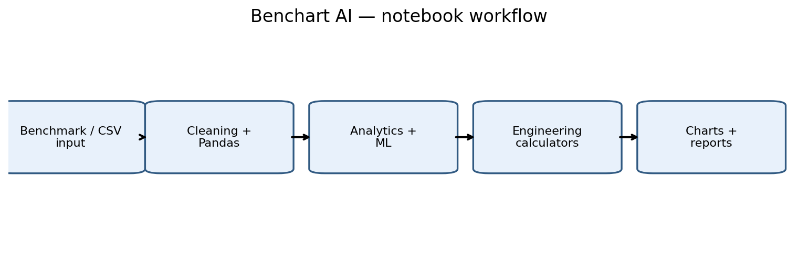
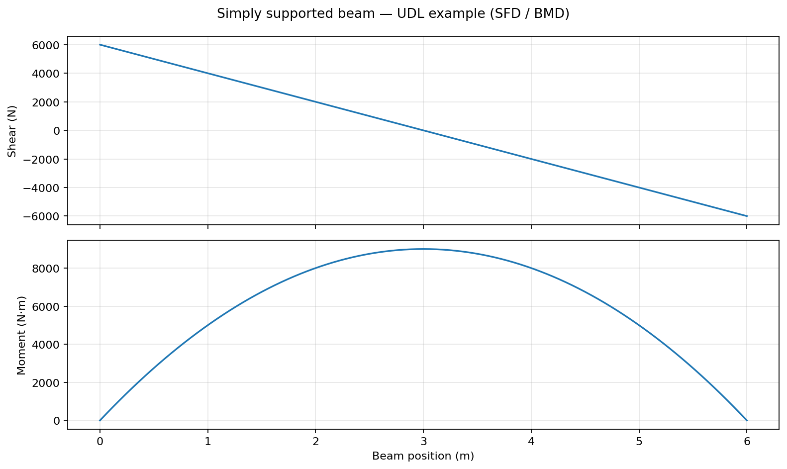
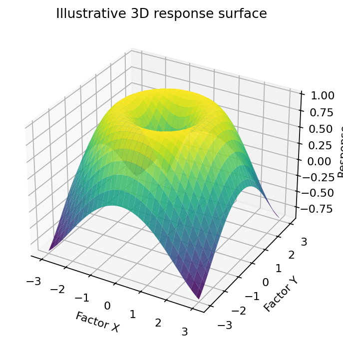
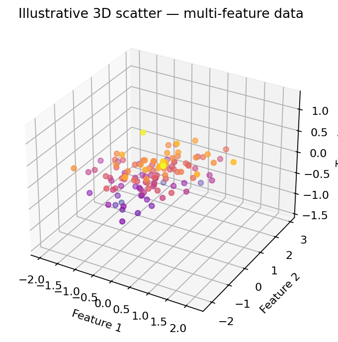
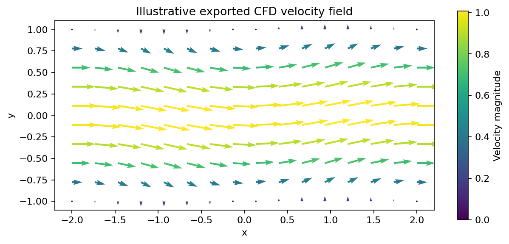
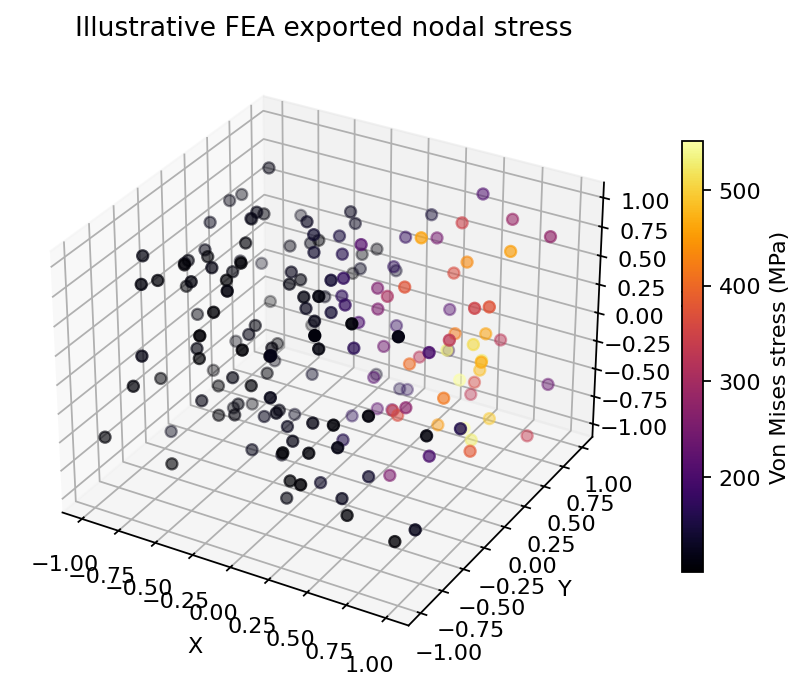
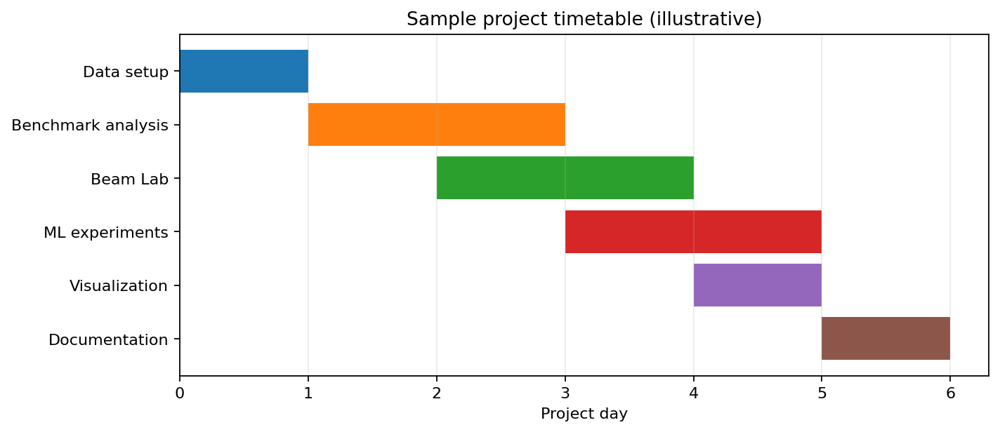

# 📊 benchart


> A web tool to visualize and compare plain text data with Android Macrobenchmark data support


<a href="https://twitter.com/theapache64" target="_blank">

</a>


> Yeah, correct, [he](https://en.wikipedia.org/wiki/Virat_Kohli)'s saying "Benchart"

## ✨ Demo

https://user-images.githubusercontent.com/9678279/204081186-36c7ce90-6c46-4ec6-9c36-dd16cdf25acf.mov

## 🐣 Getting Started

Let's start with some sample log data to learn the basics.


### 📄 Input

- Benchart accepts input as plain text.
- A block is a chunk of information that you can compare.
- Blocks are separated by a blank line.
- The first line of the block will be treated as the header line. 
  - In the above example, `# before` and `# after`.
- Remaining lines will be treated as input lines.
- In an input line, the last number is treated as the value, and anything before that as the key.
  - For example, given the input line `myFirstFunction() = 90ms`, the key will be `myFirstFunction`, and the value will be `90`.
- All special characters will be stripped out from all the lines (e.g., `(`, `)`, `=`, `#`).

### 📊 Visualization

- The X-axis of the chart is for keys.
- The Y-axis of the chart is for values.
- Headers will be given as legend.

### 💻 Result

- The result compares the blocks and shows 2 states:
  - `better`: a decrease in value.
  - `worse`: an increase in value.
- Each result line shows the change in percentage as well as the change in value.

## 🔃 The Swap

You can swap the blocks, and the results will also be swapped (see the above example to find the difference).


## 🧱 Multi-blocks

You can have `n` number of blocks. The first word of the header will be considered a group. When you have multiple blocks starting with the same word, the result will be the average of those blocks. See the example below.


## 👥 Auto Group

To color the same group with the same color on the chart, enable Auto Group.


## ➗ Auto Average

In a block, if there are multiple lines with the same key, they will be averaged.


## 🎯 Focus Group

You'll see a new element called Focus Group when auto average is performed.


Selecting a group from the Focus Group dropdown will show each value in the chart.


## 🤖 Android Support

You can paste your Macrobenchmark result data into the input box, and it'll draw custom charts for each metric.


## ⭐️ Star History

[](https://star-history.com/#theapache64/benchart&Date)

## ✍️ Author

👤 **H. S. Khasa**

## 🤝 Contributing

Contributions are what make the open-source community such an amazing place to learn, inspire, and create. Any contributions you make are greatly appreciated.

1. Open an issue first to discuss what you would like to change.
1. Fork the project.
1. Create your feature branch (`git checkout -b feature/amazing-feature`).
1. Commit your changes (`git commit -m 'Add some amazing feature'`).
1. Push to the branch (`git push origin feature/amazing-feature`).
1. Open a pull request.

Please make sure to update tests as appropriate.

## ❤ Show Your Support

Give a ⭐️ if this project helped you!


## 📝 License

This project is licensed under the MIT License. See the [LICENSE](LICENSE) file for details.

```
MIT License

Copyright (c) 2026 H. S. Khasa

Permission is hereby granted, free of charge, to any person obtaining a copy
of this software and associated documentation files (the "Software"), to deal
in the Software without restriction, including without limitation the rights
to use, copy, modify, merge, publish, distribute, sublicense, and/or sell
copies of the Software, and to permit persons to whom the Software is
furnished to do so, subject to the following conditions:

The above copyright notice and this permission notice shall be included in all
copies or substantial portions of the Software.

THE SOFTWARE IS PROVIDED "AS IS", WITHOUT WARRANTY OF ANY KIND, EXPRESS OR
IMPLIED, INCLUDING BUT NOT LIMITED TO THE WARRANTIES OF MERCHANTABILITY,
FITNESS FOR A PARTICULAR PURPOSE AND NONINFRINGEMENT. IN NO EVENT SHALL THE
AUTHORS OR COPYRIGHT HOLDERS BE LIABLE FOR ANY CLAIM, DAMAGES OR OTHER
LIABILITY, WHETHER IN AN ACTION OF CONTRACT, TORT OR OTHERWISE, ARISING FROM,
OUT OF OR IN CONNECTION WITH THE SOFTWARE OR THE USE OR OTHER DEALINGS IN THE
SOFTWARE.
```

_This README was generated by [readgen](https://github.com/theapache64/readgen)_ ❤

## 🧪 Benchart AI Python Analytics Companion

An optional Python companion has been added under [`python-analytics/`](python-analytics__README.md). It provides Pandas-based benchmark cleaning, descriptive statistics, baseline comparisons, anomaly detection, trend estimation, Matplotlib chart export, a FastAPI interface, and optional OpenCV image-resize benchmarking. See its README for installation and usage. The existing Kotlin/Compose app remains independent and unchanged; UI-to-API integration is a future phase.

See [`UPGRADE_ROADMAP.md`](UPGRADE_ROADMAP.md) for the next development phases.


## 🚀 Benchart AI Integrated Platform v3

The upgrade now includes a Three.js 3D dashboard and expanded Python API:
- `dashboard/`: interactive 3D benchmark surface and illustrative engineering beam mesh.
- `python-analytics/benchart_ai/fea.py`: FEA nodal-result post-processing with stress/displacement summaries and optional factor of safety.
- `GET /deep-learning/status`: reports whether optional PyTorch is installed and whether CUDA is available.
- `GET /dashboard/`: serves the integrated 3D analytics dashboard.
- `integrated-platform/`: Kotlin/JS API adapter example and integration instructions.

Start the service from `python-analytics/` using `uvicorn benchart_ai.api:app --host 127.0.0.1 --port 8000`. See `integrated-platform/KOTLIN_INTEGRATION.md`.

**Scope note:** The Kotlin adapter is an integration example, not yet wired into the original `HomePageUi`. The FEA feature post-processes exported solver nodal results; it is not a finite-element solver. The displayed 3D beam is sample geometry, not a validated engineering model.

## Benchart AI Integrated Platform v4
The `/dashboard/` UI now includes selectable 3D concept scenes for AI/ML, Deep Learning, Computer Vision, Robotics, CAD, CAE, FEA, CFD, Topology Optimization and Data Science. The scenes are interactive (drag to rotate, wheel/pinch to zoom). New API routes: `GET /platform/modules`, `POST /robotics/forward-kinematics`, and `POST /data-science/profile`.

**Engineering scope and limitations:** FEA is exported-result post-processing, not a solver; CFD and topology optimization views are illustrative, not solver/optimizer outputs; CAD is a concept geometry preview, not a full parametric CAD kernel; Deep Learning reports optional PyTorch/CUDA availability but does not ship pretrained models or train one automatically; Computer Vision requires optional OpenCV dependencies. The original Kotlin UI remains preserved and its API adapter is documented, but this release does not claim that all new module screens are embedded into the Kotlin Compose UI. The integrated browser dashboard is served by FastAPI.

## Benchart AI v5 — Engineering + ML upgrade

This release adds working Python workflows to the integrated dashboard:

- **Beam Lab** — analytical simply-supported beam diagrams for full-span UDL and midspan point load; optional Euler-Bernoulli maximum deflection when E and I are supplied.
- **AI/ML** — train and evaluate an in-memory RandomForest regressor or classifier from JSON tabular data, including numeric and categorical columns, imputation and one-hot encoding.
- **CFD field post-processing** — summarize exported 2D velocity samples (`x`, `y`, `u`, `v`) and calculate speed statistics.
- **API** — `/engineering/beam/analyze`, `/ml/train-tabular`, `/cfd/analyze-field`.
- **Dashboard** — Beam Lab module and interactive controls for beam, ML and CFD field workflows.

Run from `python-analytics`:

```bash
python -m venv .venv
# Windows PowerShell: .venv\\Scripts\\Activate.ps1
# Linux/macOS: source .venv/bin/activate
pip install -r requirements.txt
uvicorn benchart_ai.api:app --host 127.0.0.1 --port 8000
```

Open `http://127.0.0.1:8000/dashboard/` and API docs at `http://127.0.0.1:8000/docs`.

### Engineering scope and limitations

Beam Lab uses closed-form Euler-Bernoulli formulas for the stated idealized load cases; it is not a general beam solver. CFD functionality is exported velocity-field post-processing, not a Navier-Stokes solver. FEA remains exported-result post-processing, not a finite-element solver. CAD remains a parametric 3D concept viewer, not a CAD kernel. Topology Optimization remains a concept visualization and does not run SIMP. Deep Learning currently reports optional PyTorch/CUDA availability; it does not train a deep neural network. RandomForest training runs in-memory and does not persist model files. The original Kotlin/Compose project is preserved; the Python dashboard is a companion web interface, not yet embedded inside the Kotlin UI.

## v6 Engineering Toolbox additions

The Python companion now also includes:
- Engineering unit conversion (length, force, pressure, mass, energy, power, speed, temperature).
- Typical material-property reference library (not certified design allowables).
- Solid circular shaft elastic torsion calculator.
- Modified Goodman fatigue utilization / nominal factor-of-safety check.
- Two-level full-factorial Design of Experiments (DOE) run-plan generator.
- Numeric dataset correlation matrix endpoint.

New endpoints: `POST /tools/unit-convert`, `GET /engineering/materials`,
`POST /engineering/shaft/torsion`, `POST /engineering/fatigue/goodman`,
`POST /data-science/doe/full-factorial`, and `POST /data-science/correlation`.

These are preliminary engineering calculators and data tools, not substitutes for a validated design code, certified material datasheet, fatigue test data, or professional engineering review.


## v7 — 3D Visualization Studio

The dashboard now includes a Plotly-based 3D Visualization Studio with interactive 3D surface graphs, 3D scatter charts, 3D value charts, and a 3D project timetable. The timetable includes a task table and CSV export. Existing module-specific Three.js 3D scenes remain available. These charts use illustrative sample datasets until connected to validated solver/model output. Plotly and Three.js are loaded from CDNs, so the visualization layer requires an internet connection.


## v8 — Jupyter Notebook Edition

The project now includes a Jupyter Notebook workspace:
[`Benchart_AI_Engineering_DataScience_Lab.ipynb`](python-analytics__notebooks__Benchart_AI_Engineering_DataScience_Lab.ipynb).

The notebook covers benchmark data loading/cleaning, Pandas analysis, descriptive statistics, anomaly detection, RandomForest regression, Beam Lab SFD/BMD plots, interactive 3D charts, CFD exported-field post-processing, FEA exported-result visualization, materials, shaft torsion, Goodman fatigue checks, DOE, correlation analysis, and a project timetable. Optional sections are provided for OpenCV and PyTorch status.

### Install and launch

From the project root:

```bash
cd python-analytics
python -m venv .venv
# Windows PowerShell:
.venv\\Scripts\\Activate.ps1
# Linux/macOS:
# source .venv/bin/activate
pip install -r requirements-notebook.txt
jupyter lab
```

Open `notebooks/Benchart_AI_Engineering_DataScience_Lab.ipynb` in JupyterLab and run the cells from top to bottom. The notebook writes generated outputs to `python-analytics/outputs/`.

### Diagrams included in this README

**Notebook workflow**



**Beam Lab — shear-force and bending-moment diagrams**



**Interactive-plot examples (static README previews)**





**Engineering post-processing previews**





**Project timetable**



> Diagram note: the 3D surface/scatter and timetable previews use illustrative datasets. CFD and FEA diagrams show example exported-field/result visualizations; they are not outputs from a full CFD or FEA solver. The notebook creates interactive Plotly versions when Plotly is installed.

## 🗂️ Flat Repository Layout

This repository is kept flat (no subfolders) for easy GitHub upload. Each original path is encoded in the filename with `__` as the separator, for example `src/jsMain/kotlin/main.kt` becomes `src__jsMain__kotlin__main.kt`, and `python-analytics/benchart_ai/cli.py` becomes `python-analytics__benchart_ai__cli.py`.
